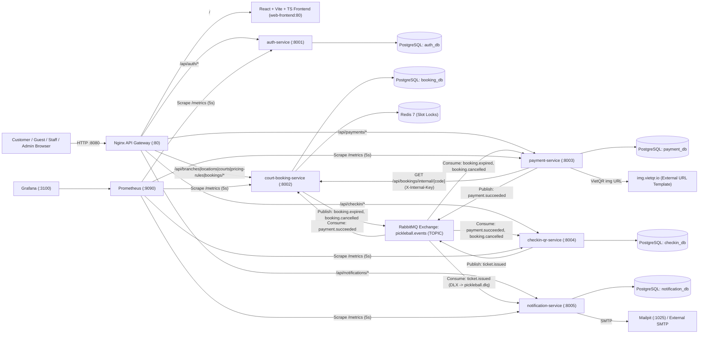

# P00 — Repository & SOA Architecture Audit

## 1. System Architecture Diagram

---

## 2. SOA Principles Evaluation

| Principle | Assessment | Evidence & Gaps |
| :--- | :--- | :--- |
| **Database Ownership** | **IMPLEMENTED** | `infra/postgres/init-multi-db.sql:1-5` creates 5 separate DBs (`auth_db`, `booking_db`, `payment_db`, `checkin_db`, `notification_db`). Each service has its own `DATABASE_URL` in `docker-compose.yml:68,91,120,151,178`. No cross-DB SQL joins. |
| **Service Autonomy & Loose Coupling** | **PARTIALLY IMPLEMENTED** | Most cross-service flows use RabbitMQ (`pickleball.events`). However, `payment-service` has a synchronous HTTP dependency on `court-booking-service` (`GET /api/bookings/internal/{booking_code}` in `payment_service.py:60-68`). |
| **Service Contracts & Abstraction** | **PARTIALLY IMPLEMENTED** | FastAPI + Pydantic v2 schemas enforce HTTP contracts. However, RabbitMQ event schemas are untyped Python dicts with no shared schema/versioning, and `booking_snapshot` is passed as an unvalidated `dict`. |
| **Statelessness** | **IMPLEMENTED** | All 5 services are stateless HTTP processes using JWT (`auth-service`) and PostgreSQL/Redis for state. |
| **Service Discoverability** | **IMPLEMENTED** | Docker Compose DNS + Nginx `resolver 127.0.0.11` (`infra/gateway/nginx.conf:5`) + OpenAPI `/docs` per service. |
| **Independent Scalability** | **PARTIALLY IMPLEMENTED** | `auth-service`, `payment-service`, `checkin-qr-service`, `notification-service` can scale horizontally (except `notification-service` has a race on duplicate email check). **`court-booking-service` CANNOT safely scale >1 replica** because `run_expiration_worker` (`booking_service.py:493-520`) polls without `FOR UPDATE SKIP LOCKED`, causing duplicate expiration processing. |
| **Fault Isolation** | **PARTIALLY IMPLEMENTED** | RabbitMQ decouples downstream consumers. However, `booking.payment_events`, `payment.booking_events`, and `checkin.events` use `message.process(requeue=False)` **with no DLQ or retry**, so transient DB errors silently drop events. |
| **Distributed Transaction Consistency** | **WEAK / AT-RISK** | **Commit-before-publish** in `booking_service.py:426-443`, `payment_service.py:144-160`, and `checkin_service.py:81-104`. No Transactional Outbox pattern. `rabbitmq.py:37-38` in all 4 RMQ services silently drops events if `self.exchange` is `None`. |
| **Observability** | **IMPLEMENTED** | All 5 services expose `/metrics` (`metrics.py`) with `prometheus_client`, scraped every 5s (`prometheus.yml`), and visualized in Grafana (`pickleball-soa-overview.json`). Nginx injects `X-Request-Id` (`nginx.conf:13`), though services do not propagate `X-Request-Id` into structured logs or RabbitMQ headers. |
| **External Provider Abstraction** | **MINIMAL / MOCKED** | VietQR is a static URL string template (`payment_service.py:26-30`) with no provider interface; email uses `aiosmtplib` directly (`email_service.py:138-146`). |

---

## 3. Critical Architectural & Concurrency Findings (CONFIRMED)

### ARCH-01 (P0): Commit-Before-Publish & Silent Event Drop Across All Producers
- **Affected Services:** `court-booking-service` (`app/services/booking_service.py:426-443`, `app/events/rabbitmq.py:37-38`), `payment-service` (`app/services/payment_service.py:144-160`, `app/events/rabbitmq.py:37-38`), `checkin-qr-service` (`app/services/checkin_service.py:81-104`, `app/events/rabbitmq.py:37-38`).
- **Current Behavior:** Each service commits its PostgreSQL transaction and *then* calls `rmq_client.publish(...)`. If RabbitMQ is temporarily disconnected (`self.exchange is None`) or publishing fails, `rabbitmq.py` silently returns or raises after the DB is already committed.
- **Real-World Failure Scenario:** Customer pays via webhook -> `payment_transactions` is committed as `SUCCEEDED`, but RabbitMQ is restarting -> `payment.succeeded` is never published -> booking stays `PENDING_PAYMENT` forever and is expired by the worker 15 minutes later while the customer's bank account was debited.
- **Recommended Minimal Fix:** Implement a lightweight **Transactional Outbox** table per producer service (write event in the same DB transaction, flush via background relay task with retry) and raise/log loudly if `exchange` is `None`.
- **Suggested Phase:** P01

### ARCH-02 (P0): No DLQ or Retry on `booking.payment_events`, `payment.booking_events`, `checkin.events`
- **Affected Services:** `court-booking-service` (`booking_service.py:485`), `payment-service` (`payment_service.py:170`), `checkin-qr-service` (`checkin_service.py:124`).
- **Current Behavior:** Only `notification-service` configures `x-dead-letter-exchange: pickleball.dlx` and `pickleball.dlq`. The other 3 consumers use `async with message.process(requeue=False):` with no DLX and no retry.
- **Real-World Failure Scenario:** A brief PostgreSQL connection blip during `payment.succeeded` consumption causes `checkin-qr-service` or `court-booking-service` to reject the message with `requeue=False`, permanently losing the event with no dead-letter record for replay.
- **Recommended Minimal Fix:** Bind `pickleball.dlx` / `pickleball.dlq` on all 4 consumer queues and add bounded retry/backoff before dead-lettering.
- **Suggested Phase:** P01

### ARCH-03 (P0): Race Condition Between Booking Expiration & Late Payment Confirmation
- **Affected Services:** `payment-service` (`app/services/payment_service.py:128-137`), `court-booking-service` (`app/services/booking_service.py:447-474`).
- **Current Behavior:**
  1. `payment_service.confirm_payment_idempotent` checks `tx.status in ("EXPIRED", "CANCELLED")` (`line 130`), **not** `tx.expires_at < now_utc`. If `booking.expired` is delayed in RabbitMQ, a late webhook succeeds.
  2. `booking_service.confirm_booking_paid` (`line 454`) only returns early if `order.status == "PAID"`, **not** if `order.status in ("EXPIRED", "CANCELLED")`. It will flip an `EXPIRED` order back to `PAID` and attempt to mark slots `BOOKED`, potentially colliding with a new booking on `uq_active_court_slot`!
- **Recommended Minimal Fix:** Enforce `expires_at` check in `payment-service` before confirming; reject/flag late payments for refund/manual review if `order.status != "PENDING_PAYMENT"` in `court-booking-service`.
- **Suggested Phase:** P01

### ARCH-04 (P1): Unsafe Redis Lock Release Without Ownership Token (Lua)
- **Affected Service:** `court-booking-service` (`app/services/booking_service.py:340-348, 429-431, 469-471`).
- **Current Behavior:** Locks are set with `redis.set(key, booking_code, nx=True, ex=900)` and released with unconditional `redis.delete(*keys)`.
- **Real-World Failure Scenario:** User A's 900s Redis TTL expires; User B acquires the lock for the same court/slot; User A's delayed expiration worker runs `release_booking_slots` and deletes User B's active Redis lock. (PostgreSQL `uq_active_court_slot` still prevents double-booking in DB, but Redis lock protection is broken).
- **Recommended Minimal Fix:** Use a Lua script (`if redis.call("get", KEYS[1]) == ARGV[1] then return redis.call("del", KEYS[1]) else return 0 end`) on release.
- **Suggested Phase:** P01

### ARCH-05 (P1): Expiration Worker Not Safe for Multiple Replicas & No DB Migration Tooling
- **Affected Services:** `court-booking-service` (`booking_service.py:493-520`), all 5 services (`Base.metadata.create_all` + ad-hoc `ALTER TABLE` in `main.py`).
- **Current Behavior:** `run_expiration_worker` queries without `FOR UPDATE SKIP LOCKED`. Schema changes rely on `create_all` + raw `ALTER TABLE` strings in `lifespan`.
- **Recommended Minimal Fix:** Add `with_for_update(skip_locked=True)` to expiration worker query; introduce Alembic migrations in P02+.
- **Suggested Phase:** P01 (worker) / P02 (migrations)
