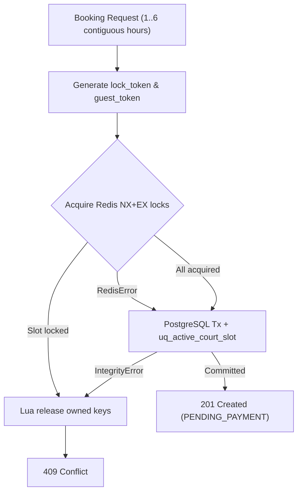

# B01 Concurrency Design — Pickleball SOA Arena

## 1. Redis Lock Ownership & Atomic Lua Release
- Every `create_booking` request generates a cryptographic per-request `lock_token = secrets.token_urlsafe(24)` and stores it on `BookingOrder.lock_token`.
- Lock keys (`lock:court:{court_id}:{play_date}:{start_hour}`) are acquired with `SET key lock_token NX EX 900`.
- Release uses atomic Lua compare-and-delete (`RELEASE_LOCK_LUA`) via `release_owned_locks(redis_client, keys, lock_token)`:
  - If the key was already expired and re-acquired by another request, `GET(key) != old_lock_token`, so the new owner's lock is preserved and `pickleball_redis_lock_ownership_mismatch_total` is incremented.
  - Partial lock acquisition failure releases only `acquired_keys` owned by the failing request.
- **Redis Unavailability**: On `RedisError`, `pickleball_redis_lock_failures_total` is incremented and reservation falls back to PostgreSQL's authoritative partial unique index `uq_active_court_slot` (`ON booking_slots (court_id, play_date, start_hour) WHERE slot_status IN ('LOCKED', 'BOOKED')`), returning HTTP `409` on conflict.

## 2. Concurrent Booking Protection Flow

## 3. Expiration Worker & State Transitions
- `expire_due_bookings_batch` claims due rows using `.order_by(BookingOrder.expires_at.asc()).limit(50).with_for_update(skip_locked=True)`.
- `release_booking_slots` uses conditional `UPDATE booking_orders SET status = :new_status WHERE id = :id AND status IN (...)` so concurrent expiration, cancellation, and payment confirmation cannot double-transition or resurrect a booking.
- **Pricing Snapshot**: `BookingOrder.total_amount` and `BookingSlot.slot_price` are persisted at reservation time and never recomputed from later `PricingRule` edits.
