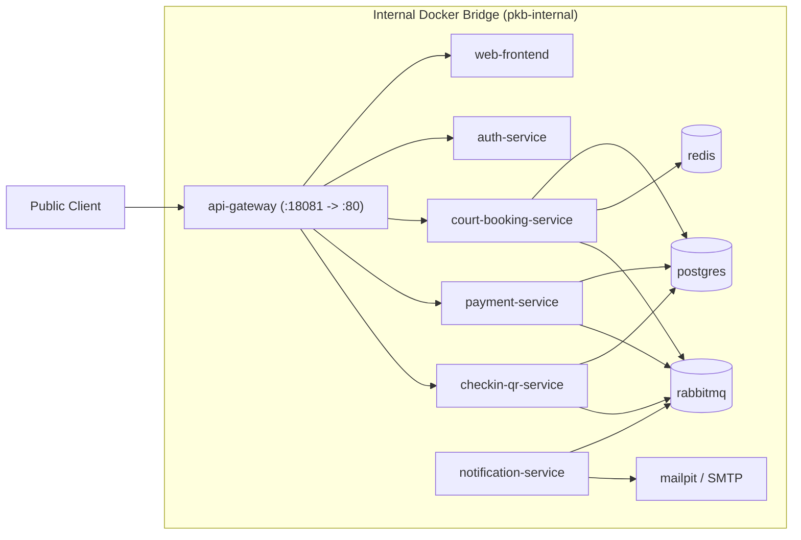

# B01 Deployment Profiles

## 1. Profiles Overview
| Profile | Compose File | `APP_ENV` | Demo Webhook / Bypass | Exposed Host Ports |
| :--- | :--- | :--- | :--- | :--- |
| **Development** | `docker-compose.yml` | `development` | Enabled (`true`) | Gateway `8080`, Services `8001-8005`, Infra `5432`, `6379`, `5672`, `8025`, `9090`, `3001` |
| **Isolated Test** | `docker-compose.test.yml` | `test` | Enabled (`true`, test secrets) | Gateway `18080`, Services `18001-18005`, Infra `15432`, `16379`, `15672`, `18025` |
| **Production-Like** | `docker-compose.prod.yml` | `production` | **Disabled (`false`)** | **Gateway only** (`PROD_GATEWAY_PORT`, default `18081`) |

## 2. Production-Like Network Topology

## 3. Startup Secret Validation (`APP_ENV=production`)
All services reject startup (`RuntimeError`) if `JWT_SECRET`, `INTERNAL_API_KEY`, `WEBHOOK_SECRET`, or `QR_HMAC_SECRET` is missing, shorter than 24 characters, or matches known development defaults.
