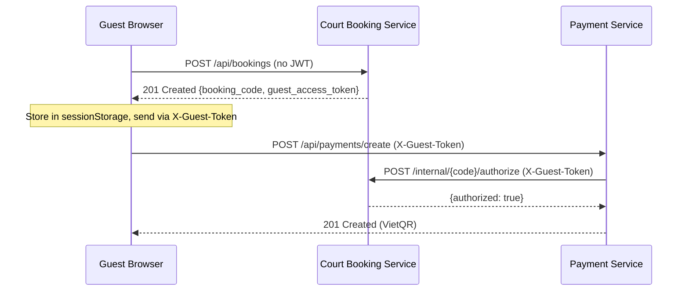

# B01 Guest Access Contract

## 1. Token Generation & Storage
- Booking references use 40-bit CSPRNG hex suffixes (`PKB-YYYYMMDD-XXXXXXXXXX`) and are identifiers, **not** authorization credentials.
- For guest bookings (`user_id is None`), `court-booking-service` generates `raw_guest_token = secrets.token_urlsafe(32)`, stores only its SHA-256 hex digest (`guest_token_hash`) in PostgreSQL, and returns `guest_access_token` **once** in the `POST /api/bookings` `201 Created` response.
- Subsequent `GET /lookup/{code}` and `GET /internal/{code}` responses never return `guest_access_token`.

## 2. Frontend Handling & Trade-offs
- The frontend stores `guest_access_token` in `sessionStorage` (`pkb_guest_token_<bookingCode>`) and sends it via the `X-Guest-Token` header on `lookup`, `cancel`, `payments/create`, `payments/booking`, and `checkin/ticket`.
- **Trade-off**: `sessionStorage` avoids URL/Referer leakage and isolates tokens to the creating browser tab session. If a guest clears browser storage or switches devices, unauthenticated lookup by booking code alone is denied (`401`/`403`) and requires operator-assisted (`STAFF`/`ADMIN`) lookup.
- **Legacy Guest Bookings**: Pre-B01 guest bookings (`user_id IS NULL AND guest_token_hash IS NULL`) are denied on public/guest endpoints and require `STAFF`/`ADMIN` assistance.

## 3. Guest Booking & Checkout Flow

