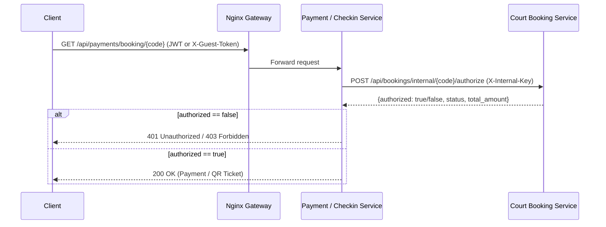

# B01 Security Architecture — Pickleball SOA Arena

## 1. Defense-in-Depth Layers
1. **Nginx API Gateway (`infra/gateway/nginx.conf`)**:
   - Rate limiting via `$binary_remote_addr` (`auth_limit`: `15r/m burst=10`, `write_limit`: `30r/m burst=20`, `read_limit`: `120r/m burst=40`, `limit_req_status 429`).
   - Blocks `/api/.*/internal/` routes (`403`).
   - Baseline headers: `X-Content-Type-Options: nosniff`, `X-Frame-Options: SAMEORIGIN`, `Referrer-Policy: strict-origin-when-cross-origin`.
2. **Service-Level Auth & Ownership**:
   - Strict JWT validation (`HS256`, `exp` enforced).
   - Active-account check on `/api/auth/login` and `/api/auth/me` (`403` when `is_active=false`). *(Stateless JWTs issued before deactivation remain valid on downstream services until `JWT_EXPIRE_MINUTES` expires — `120` min in production-like profile.)*
   - Explicit CORS `allow_origins` list (no `*` with credentials).
3. **Cross-Service Authorization (`POST /api/bookings/internal/{booking_code}/authorize`)**:
   - `payment-service` and `checkin-qr-service` authenticate callers by delegating authorization checks to `court-booking-service` with `X-Internal-Key` (`hmac.compare_digest`), failing closed (`503`/`401`/`403`) on error.

## 2. Secure Booking Access Flow

## 3. Notification & Log Hygiene
- `notification-service` escapes all dynamic fields (`html.escape(..., quote=True)`) in `_build_ticket_email`.
- Services do not log passwords, JWTs, `X-Guest-Token`, or `X-Internal-Key`.
