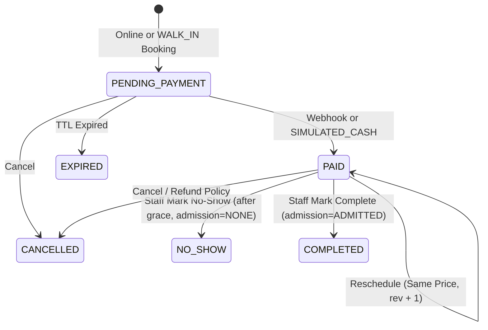

# B03 — Real-World Court Operations Overview

## 1. Scope & Architecture
B03 extends Pickleball SOA Arena across all five existing microservices without introducing new microservices or external real-money providers:

- **`court-booking-service`**: Booking rescheduling (`booking_revision`, `BookingRescheduleHistory`), walk-in bookings (`booking_source="WALK_IN"`), court maintenance blocks (`MaintenanceBlock`), operational lifecycle (`NO_SHOW`, `COMPLETED`, `admission_status`), and `OperationalAuditLog`.
- **`payment-service`**: Simulated counter cash collection (`POST /api/payments/staff/cash-collect`, `SIMULATED_CASH` / `SIMULATED_COUNTER`), booking revision sync (`POST /api/payments/internal/{code}/sync-revision`), and reschedule eligibility checks.
- **`checkin-qr-service`**: Revision-bound HMAC QR payloads (`PKB1.{id}.{code}.r{rev}.{sig}` for `rev > 1`), `booking.rescheduled` event consumer to invalidate obsolete QR versions and issue new tickets, and `expected_revision` enforcement during `claim-checkin`.
- **`notification-service`**: Subscribes to `booking.rescheduled`, `booking.no_show`, and `booking.completed` on `notification.financial_events`, persisting lifecycle emails without single-email-per-booking collision (`InboxEvent` idempotency).
- **`web-frontend`**: Customer rescheduling in `CheckoutPage.tsx`, Staff Operational Workspace (`Quét QR Check-in`, `Vận hành đơn & Tiền mặt`, `Đặt sân Walk-in`, `Lịch bảo trì`) in `StaffScannerPage.tsx`, and Admin Maintenance + Operational Audit tabs in `AdminDashboardPage.tsx`.

## 2. Operational State & Lock Diagram

