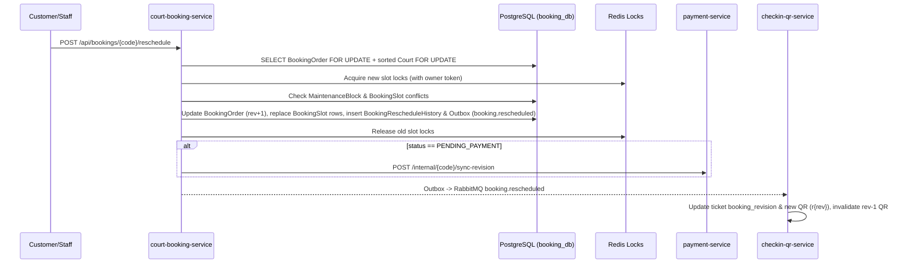

# B03 — Booking Rescheduling Design

## 1. Policy Rules
- **Unpaid (`PENDING_PAYMENT`)**: May reschedule to any contiguous available slot on active courts if not within `reschedule_cutoff_hours` (2h) for non-staff actors. Price is recalculated and synced to `payment-service` (`/api/payments/internal/{code}/sync-revision`).
- **Paid (`PAID`)**: May reschedule only when `admission_status == "NONE"` and new slot total price matches `total_amount` (`same_price == True`). Different-price changes are rejected (`400`) with cancel-and-rebook guidance.
- **Terminal / Admitted States**: `CANCELLED`, `EXPIRED`, `NO_SHOW`, `COMPLETED`, or `admission_status == "ADMITTED"` are blocked from rescheduling (`409`).

## 2. Concurrency & Ticket Revision Flow

