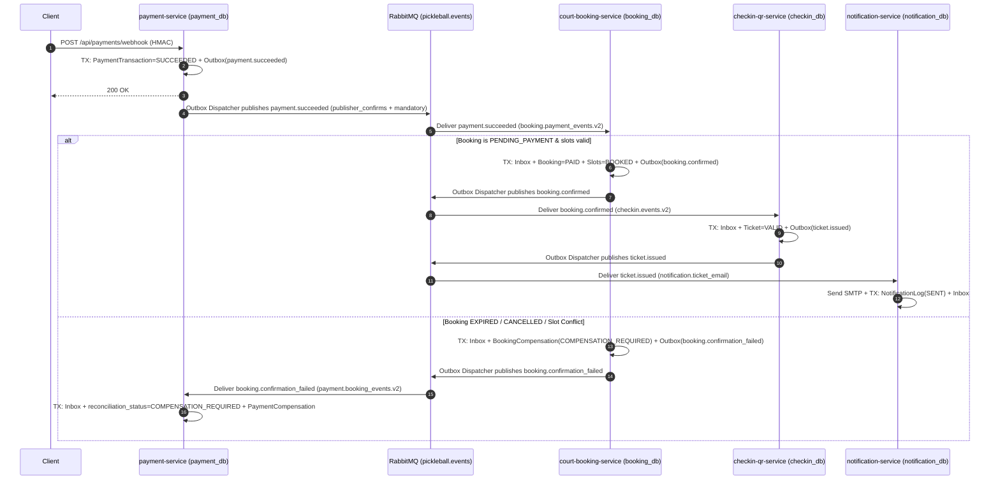

# P01 — Distributed Transaction Reliability Design

## 1. Before & After Architecture

- **Before (P00):**
  - `court-booking-service`, `payment-service`, and `checkin-qr-service` committed PostgreSQL transactions *before* calling `rmq_client.publish(...)`. If RabbitMQ was down (`self.exchange is None`), `publish()` silently returned `None`, permanently dropping events.
  - `checkin-qr-service` issued QR tickets directly from `payment.succeeded`, bypassing `court-booking-service` confirmation.
  - `booking.payment_events`, `payment.booking_events`, and `checkin.events` lacked Dead-Letter Exchanges (DLX/DLQ) and retry/inbox deduplication.
  - `aio_pika.RobustConnection` lost consumer registrations after a broker `CONNECTION_FORCED` shutdown/restart.

- **After (P01):**
  - **Transactional Outbox** (`outbox_events` table) in `court-booking-service`, `payment-service`, and `checkin-qr-service` persists business state and outbox events in the **same PostgreSQL transaction**.
  - **Asynchronous Outbox Dispatcher** claims pending events with `SELECT ... FOR UPDATE SKIP LOCKED`, publishes with `publisher_confirms=True` and `mandatory=True`, and uses bounded exponential backoff (`min(60, 2 ** min(retry_count, 6))`, max 10 retries -> `FAILED`).
  - **Durable Consumer Inbox** (`inbox_events` table with `UNIQUE (consumer_name, event_id)`) in all 4 event-driven services guarantees idempotent consumer processing (`INSERT ... ON CONFLICT DO NOTHING`).
  - **Versioned Queues + DLQ:** `booking.payment_events.v2`, `payment.booking_events.v2`, `checkin.events.v2`, and `notification.ticket_email` all route permanent/exhausted failures to `pickleball.dlx` -> `pickleball.dlq`.
  - **Reconnect Consumer Re-Registration:** `RabbitMQClient.set_consumer_setup(...)` re-initializes channels, topology, and consumers on `connection.reconnect_callbacks`.

## 2. Target Choreography Sequence

## 3. Delivery & Side-Effect Semantics

- **At-Least-Once Delivery:** Outbox polling + RabbitMQ publisher confirms + consumer `ack()` after DB commit provide at-least-once delivery; duplicate deliveries are neutralized by `inbox_events`.
- **External SMTP (Notification Service):** SMTP does not support distributed transactions. Duplicate emails are prevented using a pre-send check (`InboxEvent` + `NotificationLog(SENT)`), a partial unique index `uq_notification_sent_booking` on `(booking_code) WHERE status = 'SENT'`, and atomic `NotificationLog` + `InboxEvent` commit after SMTP acceptance.
- **Remaining Limitations (Deferred to P02/P05):** Redis lock ownership release (`Lua`) and `run_expiration_worker` `FOR UPDATE SKIP LOCKED` remain P02; automated refund execution for `COMPENSATION_REQUIRED` records remains P05.
